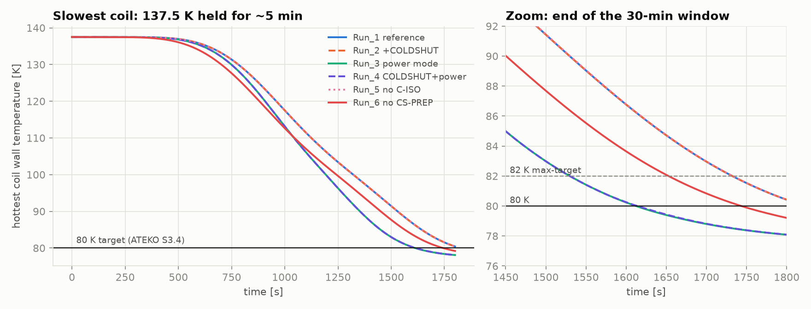
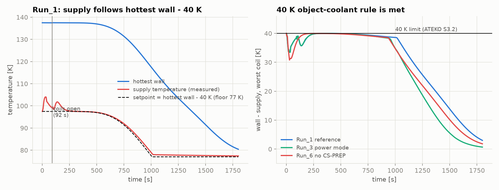
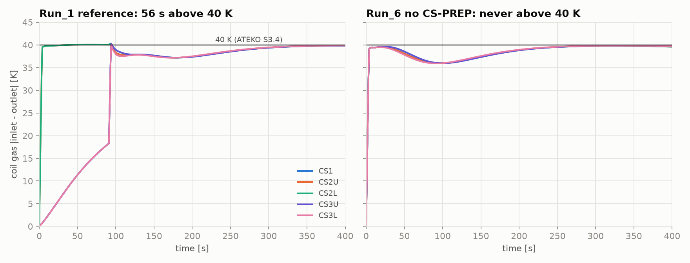
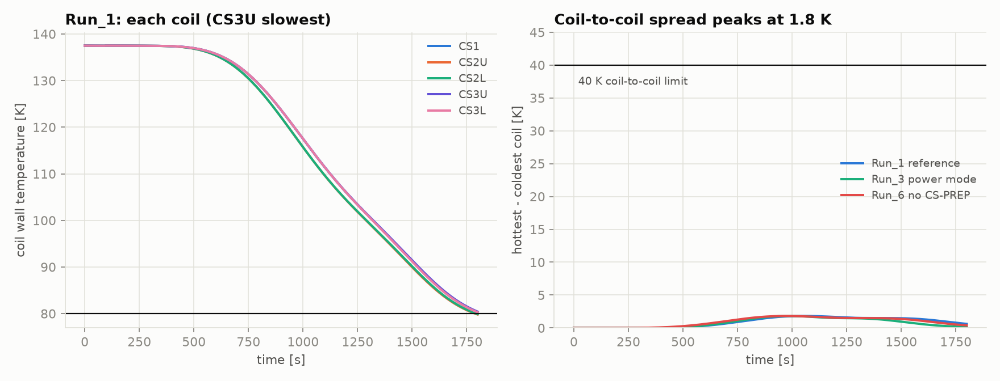
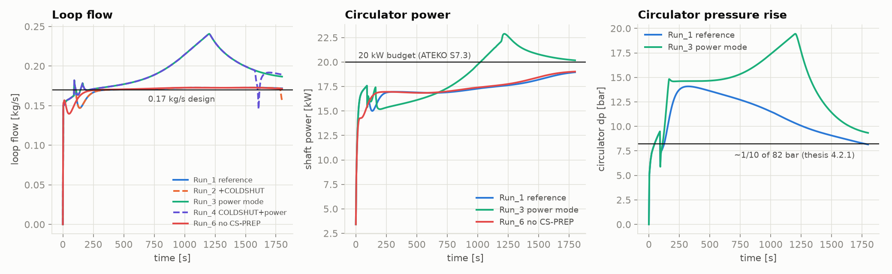
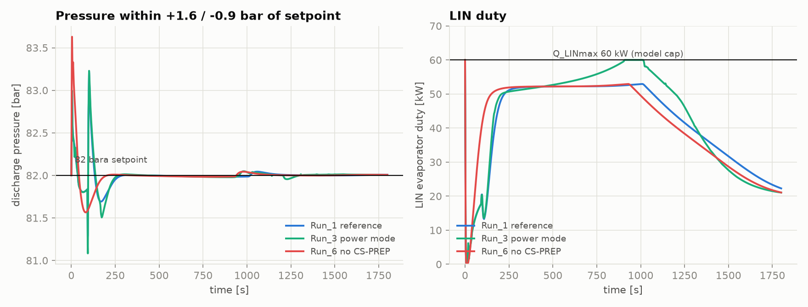
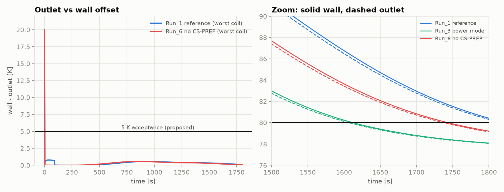
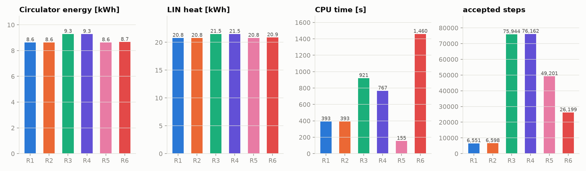

# CS paper runs 1–6 — results against the requirements

Written 2026-11-04 from `data/CS/paper/Run_1 … Run_6` (`.mat`, `dslog.txt`,
`dsin.txt`, `run.md`). All numbers below were extracted from the `.mat`
files on a 1 s grid by one script, the same for every run. Requirements are
from [requirements.md](../requirements.md) and
[../../reading-simulations.md](../../reading-simulations.md) §3.
Charts are in this folder (`01_…09_*.png`).

## 1. Summary

**What works:** the control chain that holds the 40 K rule, the pressure
loop, the flow loop, and the model's numerical robustness once it is past
the first seconds. **What does not meet requirements:** the reference
configuration ends **0.42 K above 80 K at 1800 s**, and the one setting that
fixes it (RV01 power mode) breaks the 20 kW circulator budget. The inlet–outlet
40 K limit is exceeded by 0.4 K for about 1 min in five of six runs.

| Requirement | Limit | R1 ref | R2 +COLDSHUT | R3 power | R4 both | R5 no C-ISO | R6 no CS-PREP |
|---|---|---|---|---|---|---|---|
| Slowest coil ≤ 80 K within 1800 s | 80 K | **FAIL** 80.42 K | **FAIL** 80.43 K | PASS 1613 s | PASS 1615 s | **FAIL** 80.42 K | PASS 1744 s |
| …or ≤ 82 K (ATEKO maximum target) | 82 K | pass 1733 s | pass 1733 s | pass 1530 s | pass 1530 s | pass 1733 s | pass 1653 s |
| Object − coolant (wall − supply) | ≤ 40 K | PASS 39.99 K | PASS | PASS | PASS | PASS | PASS |
| Coil gas inlet − outlet | ≤ 40 K | **marginal** 40.32 K, 56 s | 40.32 K, 56 s | 40.41 K, 57 s | 40.41 K, 57 s | 40.41 K, 57 s | PASS 39.83 K |
| Coil-to-coil spread (thesis §6.2) | ≤ 40 K | PASS 1.83 K | 1.83 K | 1.81 K | 1.81 K | 1.83 K | 1.82 K |
| Circulator power | ≤ 20 kW | PASS 18.96 kW | PASS 18.94 kW | **FAIL** 22.88 kW, 777 s over | **FAIL** 22.88 kW, 725 s over | PASS 18.96 kW | PASS 19.03 kW |
| Loop flow | 0.17 kg/s | PASS 0.172 | 0.156 (end) | 0.187–0.241 | 0.189–0.241 | 0.172 | 0.171 |
| Pressure | 82 bara, ≤ 95 barg | PASS 81.3–83.2 bar | PASS | PASS | PASS | PASS | PASS 81.6–83.6 bar |
| Supply never below 77 K | ≥ 77 K | PASS 77.41 K | PASS | PASS | PASS (77.13 K) | PASS | PASS |
| Circulator Δp (thesis §4.2.1: ≈ 1/10 of working pressure = 8.2 bar) | ≈ 8.2 bar | **exceeded** 14.1 bar | — | **exceeded** 19.5 bar | — | — | 14.1 bar |

The last row is not a model error: ATEKO's own table gives 13.7 bar at
137 K for the 30 min case (requirements.md §10, item 5), so the thesis
criterion and the ATEKO design numbers disagree. Run_1 reproduces the ATEKO
number (14.1 bar at 324 s).

## 2. What these runs are, and what they are not

- **They predate the 2026-11-03 CS-PREP redesign.** In all six runs the loop gas
  starts at 97.5 K (= 137.5 − 40), i.e. already "prepared". The new design
  starts the loop at 80 K, probes the coils, warms up and flushes
  (`control-logic.md` CS-PREP). Every conclusion about CS-PREP below applies to
  the **old** version only; `run_simulation.md` already says all runs must be
  repeated.
- **Symmetric start.** All five coils start at 137.5 K (ATEKO Tab.5), not at the
  160 K of the thesis, and not asymmetric. So C-ISO and C-COLDSHUT are barely
  tested.
- **Solver cost differs for numerical, not physical, reasons** (FIX-27): runs
  3–5 were compiled after commit `13c9717` and show a recoverable Newton failure
  at 4.85 s.

## 3. Requirement by requirement

### 3.1 Cooldown to 80 K in 30 minutes — the main shortfall

- Reference (Run_1): the slowest coil (CS3U, 714 kg) ends at **80.42 K**, CS1
  80.33 K, CS3L 80.27 K; only the two light coils (CS2U/CS2L, 349 kg) reach
  80 K, at 1789/1793 s ([09](09_final_per_coil.png)). It meets the 82 K maximum
  target at 1733 s.
- The margin is **negative by 0.42 K, about 2 min of cooling**: the last 300 s
  run at 2.2 K/min.
- The cooldown has three phases (times for Run_1):
  1. **0–~500 s, plateau.** The hottest wall cell stays at 137.5 K until 495 s
     (below 135 K at 637 s). This is the cooling-wave plateau of the 3D model
     in thesis §5.5.2; nothing the controller does shortens it.
  2. **~250–1000 s, 40 K rule binding.** The supply tracks hottest wall − 40 K,
     and wall − supply sits at 39.99 K ([03](03_supply_40K_rule.png)). The speed
     of the cooldown is set by the rule itself here.
  3. **1000–1800 s, floor and tail.** From 1008 s the setpoint is on its 77 K
     floor, the supply sits at 77.4 K, wall − supply shrinks and the cooling is
     the exponential tail at fixed flow. It needs the flow, not the control, to
     go faster.
- Where the time can be gained, from the runs:
  - Removing the 92 s old CS-PREP (Run_6): 80 K reached at 1744 s, final 79.21 K,
    so **every second at the start is a second at the end**.
  - 9 % more flow (power mode, Run_3): 80 K at 1613 s (−130 s versus the
    1743 s of Run_6, and the only 30 min pass that also keeps CS-PREP), final
    78.09 K. Cost in 3.5.

### 3.2 40 K object − coolant (ATEKO S3.2) — met, with margin wasted early

- Hottest wall − supply is **≤ 39.99 K in every run for t ≥ 60 s** (40.00 K at
  t = 0 by the initial condition). Never exceeded.
- In the first 250 s it is only 31–35 K: the measured supply sits on average
  3 K above `wanted_temp` over the first 200 s, peak +6.5 K (+9.2 K in Run_6) at
  29–32 s, caused by the heater/valve transient when the loop starts. This is
  conservative for the 40 K rule but it throws away cooling. After 100 s the
  supply tracks the setpoint to 0.95 K RMS (max 4.3 K deviation).

### 3.3 40 K inlet − outlet (ATEKO S3.4) — marginal in runs 1–5

- Runs 1–5: the worst coil channel exceeds 40 K for **56–57 s, peak 40.3–40.4 K
  at 93–94 s**, i.e. immediately after the coils open (92 s, end of the old
  CS-PREP). Excess ≤ 1 %. The first exceedance, at 39 s, happens while the coil
  valves are still shut (stagnant gas, probably not a meaningful value).
- Run_6 (coils open at t = 0): **never above 40 K** (peak 39.83 K at 328 s).
- Caveat (also in run.md): the signal is `|tube.T_gas_A − T_gas_B|` of the coil
  tubes; ATEKO S3.4's exact pair has not been matched to it. With the new
  CS-PREP the probe was already predicted to give ~57 K for a few seconds
  (`control-logic.md`), so this item needs a first look at the new runs.

### 3.4 Coil-to-coil spread — met, but untested

The five wall temperatures never differ by more than **1.83 K** (Run_1, at
1051 s), far from 40 K. The small spread comes from coil mass: the 349 kg
single-channel coils lead by 0.5–0.6 K at the end. Because the start is
symmetric, C-ISO never closes anything in any run.

### 3.5 Circulator power budget, flow and pressure drop

| | Run_1 | Run_3 | Run_6 |
|---|---|---|---|
| Energy ∫P dt | 8.64 kWh | 9.30 kWh (+7.6 %) | 8.67 kWh |
| Peak P | 18.96 kW (at the end) | **22.88 kW** | 19.03 kW |
| Time above 20 kW | 0 | **777 s** | 0 |
| Flow at end | 0.172 | 0.187 | 0.171 |
| Peak circulator Δp | 14.1 bar | **19.5 bar** | 14.1 bar |

- Flow mode holds 0.17 kg/s to 1 %, i.e. 0.0215 kg/s per channel, the
  ATEKO design value. But power rises steadily to **18.96–19.03 kW at the end
  with only 1 kW of headroom**: the 20 kW budget (ATEKO S7.3) is nearly used by
  the design flow alone.
- **Power mode overshoots its own limit.** Peak 22.9 kW at about 1220 s, over
  20 kW for 777 s (Run_4: 725 s). `run.md` for Run_3 attributes the overshoot to
  the solver recovery at 4.85 s. That does not fit the data: the peak is at
  1220 s, exactly where the flow demand peaks (0.24 kg/s), so it is the power PI
  (`k` 6e-6, `Ti` 60 s, all ASSUMED) that is too slow/weak, not a startup
  artifact. It should be tuned (FIX-14) before it is used.
- Circulator Δp is 14 bar in flow mode and 19.5 bar in power mode, against
  about 8.2 bar as the thesis loop target (see the note under the table in 1).

### 3.6 Pressure, LIN, inventory

- Pressure at the circulator discharge stays between **81.3 and 83.2 bar** (R1),
  ±1.2 bar of the 82 bar setpoint, 83.6 bar peak in Run_6; far below the 95 barg
  design pressure. Pressure control (C-PRES-a) is doing its job quietly.
- Helium moved through the reservoirs (integrated port flows; sign convention
  inferred): about 7.3 kg make-up in, 3.8 kg relief out in Run_1.
- LIN duty: 20.8 kWh in 30 min (mean 42 kW). In flow mode the steady peak is
  **52–53 kW**, 88 % of the model's 60 kW cap (`Q_LINmax` is derived by the model
  docs, not given by ATEKO). In power mode the uncapped demand exceeds the cap
  for 113 s around the flow peak, so **LIN capacity is the next constraint**
  after the circulator. The 60 kW at t = 0 is an initial transient.

### 3.7 The outlet as a stand-in for the wall (reading-simulations §5)

- Wall minus outlet, worst coil, t ≥ 60 s: **max 0.76 K** (R1–R5), 0.57 K (R6);
  at the end 0.03–0.11 K. Acceptance proposed was 5 K. The 20 K at t = 0 is the
  initial condition.
- Hottest coil by outlet = hottest by wall for 89–97 % of the time.
- Decision error: where the 80 K threshold is reached (R3, R6), the outlet reads
  ≤ 80 K **6 s earlier** than the wall (1607 vs 1613 s; 1738 vs 1744 s).
  C-COLDSHUT would act 6 s early at 80 K, a ≈ 0.2 K margin, which is harmless
  here. The check passes for **this symmetric scenario only** (and not for shut
  coils, which these runs do not stress).

## 4. Which algorithms matter

Ranked by how much each changes the result in these runs.

| # | Algorithm | Evidence | Verdict |
|---|---|---|---|
| 1 | **C-TEMP-SP-b + C-TEMP-SR** (setpoint = hottest wall − 40 K, split-range heater / evaporator / bypass) | Holds wall − supply at 39.99 K from 250 s to 950 s; supply follows the setpoint at 0.95 K RMS; reaches the 77 K floor at ~1000 s; no violation. It sets the cooldown speed in phase 2. | **Key.** Delivers the primary requirement. Risks: reads the *wall* (FIX-28), and its early transient puts the supply +3 to +9 K above the setpoint. |
| 2 | **Fixed-speed circulator (C-SPEED-b) + CS-FLOW-SP + C-RV01 flow mode** | Flow at 0.172 kg/s ±1 %, 0.0215 kg/s per channel; sets the tail (phase 3) and the power (19 kW). | **Key.** Right design flow, almost no power headroom. Relies on a loop-side flow measurement the plant lacks (FIX-15). |
| 3 | **C-RV01 power mode** | The only algorithm that moves the result: 2.3 K colder at the end, 80 K at 1613 s, 80 K or 82 K reached 130–200 s earlier. | Useful idea, **not usable as tuned**: 22.9 kW peak, 777 s over budget, 19.5 bar Δp, +7.6 % energy, 2.3× CPU. |
| 4 | **C-PRES-a** (RV07/RV08) | Pressure ±1.2 bar, no chatter, makeup 7.3 kg / relief 3.8 kg. | **Works.** Baseline. |
| 5 | **CS-PREP (old version)** | R6 vs R1: final 79.21 K vs 80.42 K; 92 s of coil-shut time; with 97.5 K gas it adds nothing for the 40 K wall rule, and the inlet–outlet excess only appears with it. | **Neutral/negative here, but moot**: it was not what is now implemented. Rerun with the new version. |
| 6 | **C-ISO** | R5 = R1 to 0.01 K, spread 1.8 K, 40 K margin never approached. | **Idle** in this scenario. Not shown to be wrong, not shown to be useful. |
| 7 | **C-COLDSHUT** | R2 ≈ R1, R4 ≈ R3 (Δ < 0.02 K); fires only after 1576 s (R4: all five coils, 1576–1608 s) or 1783–1788 s (R2: CS2U, CS2L only). Costs 3 extra state events (R2) or 17 (R4). Lowers end flow to 0.156 kg/s in R2, so lowers power slightly. | **No benefit in this scenario**, because every coil reaches 80 K within a minute of each other. |
| – | C-OVERCOOL | Off everywhere. | Archived. |

## 5. Numerics and cost

| | R1 | R2 | R3 | R4 | R5 | R6 |
|---|---|---|---|---|---|---|
| CPU [s] | 393 | 393 | 921 | 767 | 155 | 1460 |
| Accepted steps | 6551 | 6598 | 75944 | 76162 | 49201 | 26199 |
| State events | 6 | 9 | 11 | 28 | 7 | 6 |
| Newton failure at 4.85 s (FIX-27) | no | no | yes | yes | yes | no (stiff-startup warning at 2.2 s) |

CPU and steps differ by up to 10× without a physics reason (R5: 49 201 steps,
155 s; R1: 6 551 steps, 393 s). Do not compare cost between runs that were
compiled before and after `13c9717`, as already noted.

## 6. What this means

1. **The 30 min / 80 K requirement is met only with extra cooling and fails by
   0.4 K without it.** Within 20 kW and 0.17 kg/s the loop has no reserve:
   power is at 19 kW and the 40 K rule is exactly binding for 700 s. The
   design is marginal by about 1–3 %, not hopeless.
2. **Power mode shows the lever but is not tuned.** Retune (FIX-14) so that
   P stays ≤ 20 kW, then check what it still gains: a cap at 20 kW leaves
   roughly 1 kW, i.e. about 3–4 % more flow, about the 0.4 K needed. The LIN
   cap (60 kW, assumed) is next.
3. **The 82 K maximum target is met in every run** (1530–1733 s). If the
   requirement owner accepts 82 K, the reference already passes. This needs
   confirmation.
4. **Reduce the early loss.** The supply is 3 K (peak 6–9 K) above the setpoint
   in the first 200 s and the old prep spends 92 s; both cost end-of-run
   temperature one-for-one.
5. **Open decisions for the 40 K rule:** the cooldown speed is set by the rule
   (applied to the hottest wall cell). Whether it is applied to the hottest cell
   or to the mean coil temperature, and on which signal pair, is the most
   influential choice for cooldown time (requirements.md §10, item 7).

## 7. Next runs (priority)

1. Repeat Run_1 with the **new CS-PREP and the 80 K start** (and Run_6 without
   it): the inlet–outlet excess and the 92 s cost need new numbers.
2. **Asymmetric start** (one coil at 160 K, others at 137.5 K): the first test
   in which C-ISO and C-COLDSHUT have any work to do; also checks the
   outlet-as-wall proxy under real spread.
3. **160 K start** for all coils (thesis; requirements.md §10, item 1).
4. Power mode with a retuned PI.
5. Fix `run.md` for Run_3: the 22.9 kW overshoot is not the 4.85 s solver event.

## 8. Reproducing the numbers

Extraction script (scratch, not committed):
`C:\Users\PRAVOS~1\AppData\Local\Temp\claude\1f1d48d507fbc1a9\7f922326-8124-5a99-bd92-ba1a332e7bf2\scratchpad\extract.py`
(reads each `Run_N.mat` through DyMat, 1 s grid); charts from `plots.py` in the
same folder. Definitions: slowest coil = max over `T_wall_max_CS[1..5]`; supply
= `sensor_T.sensorValue`; inlet − outlet = max over coil tubes of
`|summary.T_gas_A − T_gas_B|`; power = `fan2ndOrder.P_shaft`; LIN duty =
`Q_evaporator`; pressure = `sensor_p_suction` (R1–R5) / `sensor_p_discharge`
(R6).
